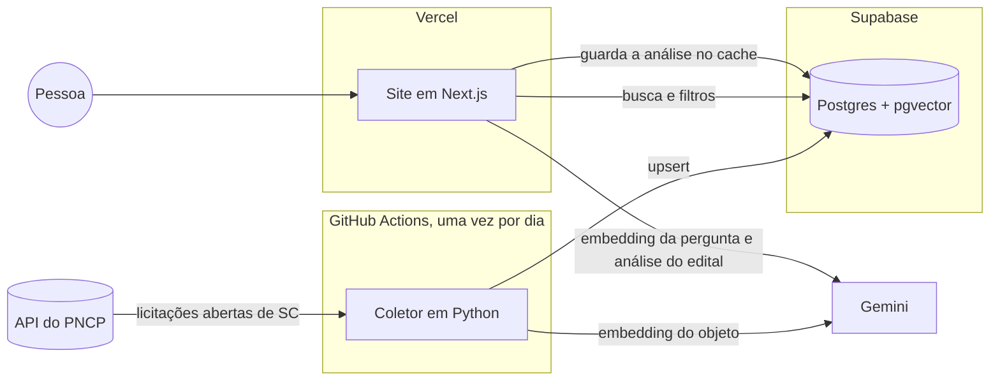

# Arquitetura

> Status: ✅ pronto · 🚧 em construção · 📋 planejado.
> Este documento é atualizado no mesmo commit das mudanças que ele descreve.

## Visão geral

| Parte | O que faz | Status |
|---|---|---|
| Coletor (`coletor/`) | busca as licitações abertas de SC no PNCP, valida e grava no banco | 🚧 coleta diária em produção desde 22/11/2026; itens, arquivos e embeddings 📋 |
| Banco (`supabase/`) | guarda licitações, itens, arquivos, análises e o log das coletas | 🚧 tabelas `contratacoes` e `coletas` com RLS, testadas no CI e aplicadas no Supabase em 22/11/2026 |
| Site (`web/`) | busca por significado, filtros, página do edital e análise com IA | 🚧 só o projeto criado |
| CI (`.github/workflows/ci.yml`) | lint, formatação, tipos, testes e build a cada push | ✅ |

As duas partes, coletor e site, só conversam pelo banco. As migrations (arquivos SQL versionados
que criam e alteram as tabelas) são o contrato entre elas. Veja o
[ADR 0001](decisoes/0001-monorepo-python-e-nextjs.md).

## Fluxos

### 1. Coleta diária 🚧

1. ✅ O GitHub Actions dispara o coletor todo dia às 6h de Brasília, ou à mão pelo botão "Run
   workflow" (`.github/workflows/coleta.yml`,
   [ADR 0003](decisoes/0003-github-actions-como-agendador.md)). A URL do banco vem do secret
   `DATABASE_URL`. A primeira execução, em 22/11/2026, leu 57 páginas e gravou 2.805
   contratações em 4 min 25 s.
2. ✅ O coletor percorre as páginas de `/v1/contratacoes/proposta?uf=SC`, com 50 registros por
   página e 3 s de pausa entre elas, porque a API tem limite de uso
   ([ADR 0002](decisoes/0002-somente-propostas-abertas-de-sc.md),
   [ADR 0005](decisoes/0005-respeitar-o-limite-de-uso-da-api.md)). Em limite de uso, erro
   temporário do servidor ou falha de rede, espera 5, 10, 20, 40 e 80 s e tenta de novo. A
   paginação termina na última página ou num HTTP 204.
3. ✅ Cada contratação é validada separadamente (Pydantic): um registro sujo é contado e ignorado,
   sem derrubar a coleta. Texto vazio vira nulo, as datas ganham o fuso de Brasília e os valores
   ficam em `Decimal`. Um registro repetido entre páginas aparece uma vez só.
4. ✅ As contratações são gravadas com **upsert** pelo `numeroControlePNCP`, todas numa transação
   só. Upsert é inserir se não existe e atualizar se existe, então rodar duas vezes não duplica
   nada. O mesmo comando conta quantas eram novas e quantas foram atualizadas, e a resposta
   original da API vai para a coluna `payload` (`coletor/src/radar_coletor/banco.py`).
5. 📋 Para cada contratação nova, o coletor busca os itens e a lista de arquivos e gera o embedding
   do objeto com o Gemini.
6. ✅ O resumo da execução (início, fim, quantidades, registros inválidos e erro) vai para a
   tabela `coletas`. Uma falha também é registrada, e a coleta termina com código de erro. Uma
   coleta sem nenhuma contratação válida conta como falha, porque indica problema na fonte.
   O comando é `python -m radar_coletor` (`coletor/src/radar_coletor/coleta.py`).

O cliente da API fica em `coletor/src/radar_coletor/cliente.py` e os modelos em
`coletor/src/radar_coletor/modelos.py`. Em 18/11/2026 o modelo validou as 2.704 contratações
abertas de SC sem rejeitar nenhuma.

### 2. Busca "O que sua empresa vende?" 🚧

1. 🚧 **Busca por palavras.** A coluna `busca` (`tsvector`) de `contratacoes` é calculada pelo
   próprio Postgres a partir do objeto (peso maior) e do nome do órgão, com uma configuração em
   português que ignora acentos e plurais: `normalizar_para_busca` tira os acentos e troca a
   terminação do plural pela do singular ("contratações" → "contratacao"), e depois vem o radical
   do português. A função
   `buscar_contratacoes(texto, município, modalidade, prazo, página)` devolve só licitações
   abertas (situação "Divulgada no PNCP" e prazo futuro), ordenadas pela relevância ou pelo prazo,
   20 por página, com o total. `opcoes_de_filtro()` monta os seletores. As duas rodam com as
   permissões de quem chama, então o RLS vale
   ([ADR 0008](decisoes/0008-busca-numa-funcao-sql.md)). O site ainda não usa a função.
2. 📋 O servidor do site gera o embedding do texto digitado. A chave do Gemini nunca vai para o
   navegador.
3. 📋 O Postgres combina a busca por significado (pgvector) com a busca por palavras. Isso se
   chama **busca híbrida**, e só a função muda: a tela continua igual.
4. 📋 Filtros futuros: valor e exclusividade para micro e pequenas empresas.

### 3. Análise do edital com IA 📋

1. A pessoa clica em "Analisar com IA".
2. Se a análise já está na tabela `analises` (o cache), ela aparece na hora.
3. Senão, o servidor baixa o PDF do edital, envia ao Gemini e pede um JSON com resumo, prazo, valor
   e exigências de habilitação. Cada exigência vem com a página e o trecho de onde foi tirada.
4. A resposta é validada por esquema antes de ser salva e exibida. O texto do edital é tratado
   como dado, nunca como instrução (proteção contra prompt injection).
5. Um limite por IP e um teto diário protegem a cota gratuita do Gemini.

## Modelo de dados

As tabelas são criadas pelas migrations em `supabase/migrations/` e testadas no CI contra um
Postgres 17 descartável ([ADR 0007](decisoes/0007-postgres-comum-nos-testes-de-banco.md)).

| Tabela | Chave | Conteúdo | Status |
|---|---|---|---|
| `contratacoes` | `numero_controle_pncp` | órgão, município, modalidade, situação, objeto, valores (`numeric(18,2)`), datas (`timestamptz`), link de origem, resposta original da API (`payload jsonb`), primeira e última coleta | ✅ migration |
| `coletas` | `id` | início, fim, status, páginas, novas, atualizadas, registros inválidos (`jsonb`) e erro de cada execução | ✅ migration |
| `itens` | `(numero_controle_pncp, numero_item)` | descrição, quantidade, unidade, valores e benefício para ME/EPP | 📋 |
| `arquivos` | `(numero_controle_pncp, sequencial_documento)` | título, tipo e URL | 📋 |
| `analises` | `numero_controle_pncp` | JSON validado da análise, modelo usado e data | 📋 |

A coluna `busca` (`tsvector`, gerada pelo banco) já existe em `contratacoes`. O embedding
(`vector`) entra no passo da busca por significado. Uma contratação que sai da lista de abertas não é apagada: só deixa de ser atualizada.

## Segurança

- ✅ RLS em `contratacoes` e `coletas`: o público (`anon`, `authenticated`) só lê, e não há
  política de escrita. Os testes conferem que, como `anon`, ler funciona e gravar, alterar ou
  apagar é barrado.
- ✅ O coletor grava como dono das tabelas, com SQL direto pelo psycopg
  ([ADR 0006](decisoes/0006-sql-direto-com-psycopg.md)).
- 📋 RLS nas tabelas futuras: o público só lê. Só o coletor e o servidor do site escrevem.
- Chaves secretas só no servidor (secrets do GitHub Actions e variáveis de ambiente da Vercel).
- Validação de toda entrada (Pydantic no coletor, Zod no site).
- Cache, limite por IP e teto diário na rota de IA.

## Decisões

O que foi decidido, as alternativas e o porquê: [decisoes/](decisoes/README.md).
