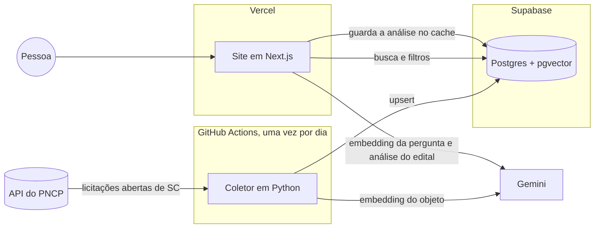

# Arquitetura

> Status: ✅ pronto · 🚧 em construção · 📋 planejado.
> Este documento é atualizado no mesmo commit das mudanças que ele descreve.

## Visão geral

| Parte | O que faz | Status |
|---|---|---|
| Coletor (`coletor/`) | busca as licitações abertas de SC no PNCP, valida e grava no banco | 🚧 conversão de datas pronta; coleta 📋 |
| Banco | guarda licitações, itens, arquivos, análises e o log das coletas | 📋 |
| Site (`web/`) | busca por significado, filtros, página do edital e análise com IA | 🚧 só o projeto criado |
| CI (`.github/workflows/ci.yml`) | lint, formatação, tipos, testes e build a cada push | ✅ |

As duas partes, coletor e site, só conversam pelo banco. As migrations (arquivos SQL versionados
que criam e alteram as tabelas) são o contrato entre elas. Veja o
[ADR 0001](decisoes/0001-monorepo-python-e-nextjs.md).

## Fluxos

### 1. Coleta diária 📋

1. O GitHub Actions dispara o coletor uma vez por dia
   ([ADR 0003](decisoes/0003-github-actions-como-agendador.md)).
2. O coletor percorre as páginas de `/v1/contratacoes/proposta?uf=SC`, com até 50 registros por
   página ([ADR 0002](decisoes/0002-somente-propostas-abertas-de-sc.md)). Em caso de erro ou de
   limite da API, espera e tenta de novo.
3. Cada contratação é validada (Pydantic), as datas são convertidas para o horário de Brasília e o
   registro é gravado com **upsert** pelo `numeroControlePNCP`. Upsert é inserir se não existe e
   atualizar se existe, então rodar duas vezes não duplica nada.
4. Para cada contratação nova, o coletor busca os itens e a lista de arquivos e gera o embedding
   do objeto com o Gemini.
5. O resumo da execução (início, fim, quantidades e erro) vai para a tabela `coletas`.

### 2. Busca "O que sua empresa vende?" 📋

1. O servidor do site gera o embedding do texto digitado. A chave do Gemini nunca vai para o
   navegador.
2. O Postgres combina a busca por significado (pgvector) com a busca por palavras (full-text em
   português). Isso se chama **busca híbrida**.
3. Filtros: município, valor, prazo e exclusividade para micro e pequenas empresas.

### 3. Análise do edital com IA 📋

1. A pessoa clica em "Analisar com IA".
2. Se a análise já está na tabela `analises` (o cache), ela aparece na hora.
3. Senão, o servidor baixa o PDF do edital, envia ao Gemini e pede um JSON com resumo, prazo, valor
   e exigências de habilitação. Cada exigência vem com a página e o trecho de onde foi tirada.
4. A resposta é validada por esquema antes de ser salva e exibida. O texto do edital é tratado
   como dado, nunca como instrução (proteção contra prompt injection).
5. Um limite por IP e um teto diário protegem a cota gratuita do Gemini.

## Modelo de dados 📋

| Tabela | Chave | Conteúdo |
|---|---|---|
| `contratacoes` | `numero_controle_pncp` | órgão, município, modalidade, objeto, valor estimado (`numeric`), datas (`timestamptz`), link de origem, resposta original da API (`jsonb`), coluna de busca por palavras (`tsvector`) e embedding (`vector`) |
| `itens` | `(numero_controle_pncp, numero_item)` | descrição, quantidade, unidade, valores e benefício para ME/EPP |
| `arquivos` | `(numero_controle_pncp, sequencial_documento)` | título, tipo e URL |
| `analises` | `numero_controle_pncp` | JSON validado da análise, modelo usado e data |
| `coletas` | `id` | início, fim, status, quantidades e erro de cada execução |

## Segurança 📋

- RLS em todas as tabelas: o público só lê. Só o coletor e o servidor do site escrevem.
- Chaves secretas só no servidor (secrets do GitHub Actions e variáveis de ambiente da Vercel).
- Validação de toda entrada (Pydantic no coletor, Zod no site).
- Cache, limite por IP e teto diário na rota de IA.

## Decisões

O que foi decidido, as alternativas e o porquê: [decisoes/](decisoes/README.md).
